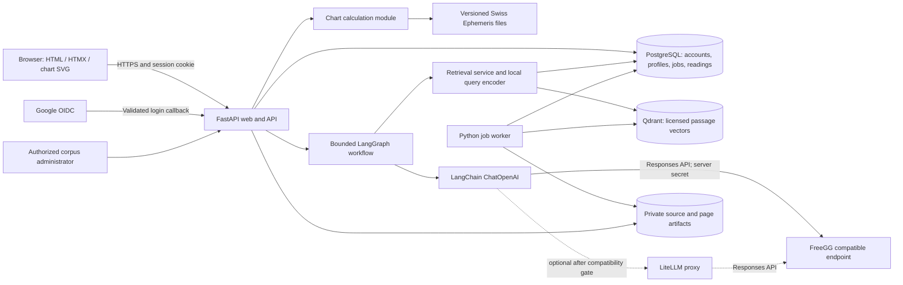

# System architecture

## Chosen shape

A modular Python application, one background worker using the same package, PostgreSQL for transactional state and job leasing, Qdrant for public licensed source retrieval, and private object storage for source artifacts. The UI is server-rendered FastAPI/Jinja2 with HTMX for incremental updates and a compiled Tailwind stylesheet. Small chart interactions use ordinary JavaScript and accessible SVG; calculation remains server-side.

LangChain adapts the model API. LangGraph expresses a bounded, inspectable workflow. This is not a team of autonomous agents in production. Research agents used to prepare this plan do not imply the deployed application needs dozens of agents.

## Components



The direct provider and gateway paths are alternatives, not two simultaneous requests. The first deployment uses the direct path. On the constrained free demo, ingestion runs on an operator workstation; durable hosted ingestion requires worker capacity. Local query encoding still requires a measured memory budget on the web host.

## Responsibilities and boundaries

| Module | Owns | Must not do |
|---|---|---|
| Identity | Google identity, sessions, ownership, consent | Treat email as immutable identity |
| Profiles | Birth inputs and revisions, privacy | Guess missing time or location silently |
| Calculations | UTC resolution, ephemeris, versioned facts | Ask the LLM to calculate a chart |
| Corpus | Rights records, immutable editions/passages | Publish unreviewed or unlicensed material |
| Retrieval | Metadata filters, dense/sparse search, evidence bundle | Interpret similarity as truth probability |
| Answers | Controlled workflow, citation verification, answer storage | Invent sources or execute source instructions |
| Jobs | Lease, retry, cancellation, idempotency | Use ephemeral web tasks for durable ingestion |
| Presentation | User-visible labels, excerpts, accessibility | Hide uncertainty behind a decorative confidence score |

## Personalized answer flow

```mermaid
sequenceDiagram
    actor User
    participant Web
    participant DB as PostgreSQL
    participant Calc as Chart service
    participant R as Retrieval
    participant LLM as Responses provider
    User->>Web: Question + owned profile revision
    Web->>DB: Authorize, enforce quota, create request
    Web->>Calc: Calculate or load immutable chart snapshot
    Calc-->>Web: Facts + unavailable facts + settings manifest
    Web->>R: Question, facts, tradition and rights filters
    R-->>Web: Passage IDs, exact excerpts, metadata, conflicts
    alt Evidence sufficient
        Web->>LLM: Minimized facts + bounded evidence + answer schema
        LLM-->>Web: Proposed structured answer
        Web->>Web: Validate facts, citation IDs, quoted spans, applicability
        Web->>DB: Store validated answer and evidence manifest
        Web-->>User: Facts / sources / interpretation / limits
    else Evidence missing or validation fails
        Web->>DB: Store qualified result or failure state
        Web-->>User: Explain what is missing; no invented conclusion
    end
```

MVP answer generation is a bounded HTTP request, with persisted request state and polling after a disconnected client. A crashed generating request becomes failed/unknown after its deadline; it is never silently replayed. Later worker execution can reuse the same request contract. No hidden provider retry after uncertain transmission.

## Workflow nodes

1. Authorize and validate question length and profile ownership.
2. Resolve calculation settings and birth-time precision; request clarification if needed.
3. Calculate/load chart facts; produce only stable facts for uncertain intervals.
4. Build a deterministic question/topic retrieval request; any optional LLM query rewrite cannot change chart facts.
5. Retrieve passages and parent context; filter by tradition, rights, edition status and corpus generation.
6. Evaluate whether the passages actually discuss the queried factors; abstain where insufficient.
7. Generate a structured explanation using one provider call.
8. Validate citation IDs, quote spans, chart fact IDs, schema, and prohibited claims. Allow at most one bounded repair call.
9. Persist a final immutable record or a qualified failure. An uncited claim is removed or causes abstention.

Maximum two generation calls per question; default no automatic network retries. Proposed total request deadline 150 seconds, provider call timeout at most 120 seconds and reduced to remaining deadline for a repair. A repair cannot reset the budget. Limit question to 2,000 characters, context to 6,000 generation-token equivalent and output to 1,800 tokens after provider capability test. These are starting limits to benchmark, not known provider guarantees.

## Storage boundaries

PostgreSQL is authoritative for ownership, rights, publication state, passages and source coordinates. Qdrant is a rebuildable index containing passage IDs, embeddings and minimal filter metadata. Exact excerpts are loaded from PostgreSQL after reauthorization, not trusted directly from vector payloads. Private raw scans stay in access-controlled object storage. Chart snapshots and reading manifests record immutable inputs and versions.

Publish a corpus generation only after every expected passage is stored and indexed. Retrieval captures the active PostgreSQL generation and its physical Qdrant collection; an operational alias does not provide cross-store atomicity. A rights withdrawal immediately prevents serving passages and invalidates cached excerpts; asynchronous index deletion follows. Interrupted ingestion never activates a partial generation.

## Scaling path

Start with one web process, one query encoder instance and small curated corpus. Ingestion and OCR run off the request path. Scale web and worker independently only after measuring CPU/RAM and latency. Add a dedicated embedding service when measured memory duplication warrants it. Add Redis or a larger queue only when database job contention/throughput justifies it. Do not introduce Kubernetes for the initial product.

## Reproducibility

A chart snapshot includes profile revision hash, timezone and tzdata version, ephemeris version/checksums, flags and settings. An answer includes chart hash, corpus generation, passage hashes, retrieval configuration, embedding revision, workflow/prompt versions, requested and reported model identifiers, provider request ID if available, and generation parameters. Model outputs may vary even at low temperature; preserve the exact answer and evidence rather than promising identical regeneration.

## Technology reference targets

Primary LangGraph workflow documentation was retrieved directly with HTTP 200 on 2026-11-15: https://docs.langchain.com/oss/python/langgraph/workflows-agents . Its workflow/agent distinction supports the bounded workflow choice; exact library APIs must be checked against the pinned release during implementation. Provider and database specifics are documented with their own sources in the relevant context files.


## Index and transaction research

[30 PostgreSQL consistency](30-postgres-jobs-and-consistency.md) and [31 Qdrant operations](31-qdrant-index-and-capacity.md) expand queue fencing, RLS/pool identity, quota reservations, physical collection pinning, staged publication and rights withdrawal. These are design requirements, not executed database tests.
