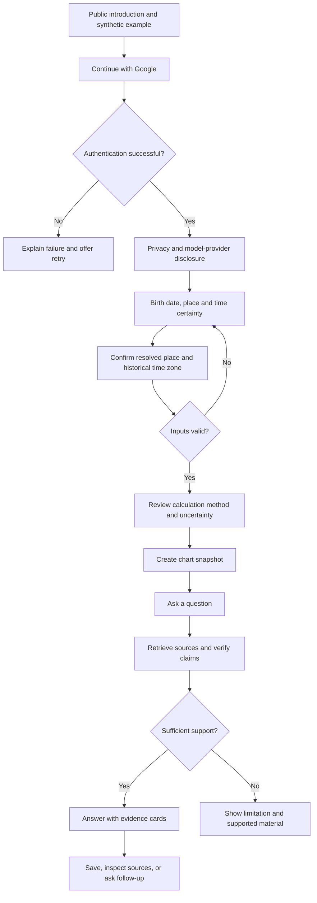

# UI, configuration, and user flows

Status: proposed design; no UI has been implemented. Prepared 2026-11-15. These are product decisions, not claims about an existing application.

## Experience and delivery stack

Use FastAPI with Jinja2 server-rendered HTML, HTMX for partial updates, and compiled Tailwind CSS. Keep meaningful URLs and ordinary form submissions so chart and library pages remain usable without client-side enhancement. Build chart graphics as escaped, application-owned SVG with an adjacent accessible data table. Do not render model-generated HTML or SVG.

This keeps the main stack Python and the first deployment small. A small asset compilation step is acceptable; it does not require a separate Node production service. Defer a React SPA and native mobile apps until a demonstrated interaction requirement justifies the extra deployment and state management. FastAPI documents template integration, and HTMX documents progressive enhancement; these sources establish capability, not performance guarantees. [FastAPI templates](https://fastapi.tiangolo.com/advanced/templates/) · [HTMX documentation](https://htmx.org/docs/)

The product should feel like a calm reading desk: readable explanations, a chart when relevant, and clearly attributed sources. Avoid fear-inducing notifications, countdowns, cosmic certainty percentages, or visual treatment that makes traditional interpretations look like clinical test results.

## Navigation and routes

| Screen | Proposed route | Access | Main action |
|---|---|---|---|
| Introduction and example | `/` | Public | Understand the method and inspect a synthetic example |
| Sign in | `/login` | Public | Continue with Google |
| Birth profile | `/profiles/new` and `/profiles/{id}/edit` | Owner | Enter or correct birth inputs |
| Reading workspace | `/readings/new` | Signed in | Ask a question against a selected profile |
| Reading detail | `/readings/{id}` | Owner | Read answer, chart facts and sources |
| Chart detail | `/charts/{id}` | Owner | Inspect placements, uncertainty and method |
| Library | `/library` | Public approved metadata | Explore the published corpus and its limits |
| Source detail | `/library/{edition_id}` | According to excerpt rights | Inspect bibliographic metadata and permitted passages |
| Saved readings | `/readings` | Owner | Search own prior questions and versions |
| Settings | `/settings` | Owner | Language, display, privacy, export and deletion |
| Corpus review | `/admin/corpus` | Explicit curator role | Review rights, OCR and publication status |

Route ownership checks apply on the server to full pages, fragments, exports and streaming/polling requests. A hidden navigation link is not authorization. Never put birth inputs, questions, email addresses or session tokens in URLs.

## First-use journey



The public example uses invented inputs and explicitly labelled sample evidence. It must never masquerade as a live reading. Google login does not silently grant permission to send sensitive data to an AI provider. Before the first external model request, explain the minimum fields transmitted, purpose and retention policy in plain language. If consent is declined, retain access to local chart and library features allowed by policy.

## Birth input form

Require date of birth, birthplace and a time-certainty choice. Exact birth time is optional; the UI must support “I do not know.” A display name is optional and can be a pseudonym. Do not require gender, marital status, religion, caste, occupation or a current GPS location for basic chart calculation.

- Date: labelled day/month/year fields or an unambiguous localized date input; show the normalized calendar date for confirmation.
- Time certainty: exact, approximate, or unknown. “Exact” describes what the user reports, not verified accuracy.
- Exact: local time with explicit 12/24-hour indication. Approximate: time interval, not a fabricated precision score. Unknown: no mandatory placeholder time.
- Place: search results show city, region and country; ask the user to confirm one. Support manual coordinates plus time-zone selection when lookup fails.
- Time zone: show the historical zone/offset used. Ambiguous or nonexistent local times require correction or explicit disambiguation before a precise chart.
- Calculation method: compact summary above Create chart; Vedic/sidereal, selected ayanamsa, house method and node mode. Defaults are visible, not hidden behind an expert-only screen.
- Review screen: echo all input values and uncertainty before creation. Editing inputs creates a new chart version; old answers keep their original provenance.

Unknown or broad time intervals disable unsupported ascendant/house claims. If a planet or timing classification changes within the interval, show alternatives and withhold a single precise interpretation. Sampling is a sensitivity approximation unless the calculation engine proves interval bounds; do not label it exhaustive.

## Reading workspace wireframe

```text
+-----------------------------------------------------------------------+
| Product name     Readings     Library                     Account      |
+-----------------------------------------------------------------------+
| Profile: My chart    Birth time: approximate    Method: Vedic / Lahiri  |
|                                                                       |
| What would you like to explore?                                       |
| [Question input                                                ] Ask |
|                                                                       |
| Answer                                            Chart facts         |
| Short response in ordinary language.             Placement table      |
|                                                                       |
| TRADITIONAL INTERPRETATION [1]                     Method and inputs    |
| A source-based interpretation and its limits.     Uncertain factors    |
|                                                                       |
| AI SYNTHESIS [1][2]                                                    |
| How the cited rules may relate; alternative view.                      |
|                                                                       |
| Sources   [1] Work / edition / chapter / verse or page                  |
|           [2] Work / edition / chapter / verse or page                  |
| [Inspect passage]  [See disagreements]  [Report citation issue]        |
+-----------------------------------------------------------------------+
```

On a narrow screen, answer comes first, then chart facts and source cards. A source opens inline or in a full-page view with a stable back link; do not trap the reader in stacked modals. The question remains editable after a recoverable error.

## Answer structure and evidence interaction

Render structured server-validated fields in this order:

1. Direct, concise answer or an explicit lack-of-support message.
2. Relevant calculated chart facts with chart snapshot and method identifiers.
3. Traditional rule/application with adjacent citation markers.
4. AI synthesis labelled as synthesis; no hidden reasoning transcript or purported proof of future events.
5. Alternative rules, contradictions, time uncertainty and missing information.
6. Sources and optional explanatory glossary.

Each citation card shows work, attributed author, edition, translator, original language, chapter/verse when available, printed page and scan page when different, short permitted excerpt, original/translation toggle when available, and a source link. Show whether translation is editorial or machine-assisted. Highlight the supporting span; avoid presenting an entire page as proof of a specific assertion. Respect excerpt rights and display a metadata-only card when reproduction is not permitted.

Evidence labels have specific meanings: **calculated** describes engine output; **traditional interpretation** describes a sourced rule; **AI synthesis** describes a generated connection. “Supported by this passage” does not mean scientifically proven. Retrieval score is never exposed as the probability of a prediction coming true. When the server rejects a citation, the UI omits the affected assertion or shows a clear unsupported state; it never displays an unverified citation as verified.

Stream progress states such as “Calculating chart”, “Finding passages”, and “Checking references”. Release answer text only after its citations pass the publication gate. A long answer can be delivered in validated sections later; the first release may deliver one verified response. Stop/cancel requests should stop further generation where supported and label already-incurred usage accurately.

## Failure and empty states

| Condition | User experience | Recovery |
|---|---|---|
| Google canceled or login failed | Plain sign-in error, no false account success | Retry; preserve public navigation |
| Session expired | Return to login; no sensitive content in redirect URL | Resume authorized screen after login |
| Place not found | Explain that location could not be resolved | Retry or manually provide coordinates/zone |
| Unknown birth time | Describe which chart factors are unavailable | Continue with supported calculations |
| Corpus has no relevant approved passage | Say the library cannot support the requested reading | Offer supported concepts or a better-scoped question |
| Sources disagree | Show competing interpretations with tradition/edition labels | Let the user inspect both |
| Provider unavailable or timed out | Keep chart and source material visible | Explicit retry; no invented cached response |
| Request limit reached | Explain limit and reset timing without fear or urgency | Read existing material; retry later |
| Citation fails verification | No verified badge or fabricated source | Publish only supported parts or fail gracefully |
| Answer canceled | Mark the reading canceled, not completed | Resume as a new request if desired |
| Source withdrawn | Mark prior answer's source unavailable/withdrawn | Explain provenance status; exclude from new answers |
| Deletion pending | Show scope and status | Track completion and backup expiry policy |

## Settings, privacy and library controls

Preferences: English first, light/dark/system theme, text size, 12/24-hour display, chart rendering style, and default answer detail. Hindi/Sanskrit text can be displayed in source cards, but full multilingual answering requires retrieval and editorial evaluation before enablement. Chart style changes presentation; method changes require a new calculation version.

Privacy settings: export profile and readings, delete one reading, delete profile with affected readings, delete account, and manage provider-sharing consent. Clearly state what is deleted immediately and when backups expire. Do not promise erasure of copies held by another service unless that service guarantees it. Requests to delete or export require an authenticated owner and protection against cross-site requests.

Library page: show the number of approved editions and searchable passages, covered traditions/languages, limitations, last publication date, and rights status. Never equate a candidate bibliography with an ingested corpus. Curator workflow requires edition metadata, permissions evidence, OCR review, publication decision and withdrawal; ordinary users cannot publish source text. Private document upload is deferred unless per-user isolation and rights review are designed.

## UI configuration contract

These values are starting design choices and must pass browser/contrast checks before release; they are not accessibility certification.

| Token or preference | Initial proposal |
|---|---|
| Default theme | System; light palette below |
| Page / surface | `#F7F5F0` / `#FFFFFF` |
| Primary text / secondary text | `#18222D` / `#4A5663` |
| Accent | `#4B3F8F` |
| Borders | `#C8CDD3` |
| Error | `#A52626`, with text and icon |
| Base type | System UI; locally hosted Noto Sans Devanagari for relevant source text |
| Body size / line height | 16px / 1.6; honor browser zoom |
| Reading width | 72 characters maximum for long passages |
| Spacing scale | 4, 8, 12, 16, 24, 32, 48px |
| Control target | At least 44 by 44px design target |
| Breakpoints | 640px and 1024px; content must work at 320px width |
| Motion | Minimal; obey reduced-motion preference |
| Evidence detail default | Summary with expandable passages |
| Date storage/display | Canonical server date/time; locale-aware display with explicit zone |

Public configuration may contain feature flags, supported languages, display defaults and a provider disclosure label. It must never contain provider keys, OAuth client secrets, database URLs, internal prompts or access tokens. Operational flags must be enforced by the server as well as reflected in the interface.

## Accessibility, security and acceptance checks

Target WCAG 2.2 AA with keyboard navigation, visible unobscured focus, meaningful labels, accessible validation summaries, sufficient contrast, zoom/reflow, and text alternatives. SVG charts must have accessible titles and equivalent tabular data; planetary glyphs require names. Status updates use a polite live region and do not move focus unexpectedly. W3C defines the conformance criteria; manual checks remain necessary in addition to automation. [WCAG 2.2](https://www.w3.org/TR/WCAG22/)

Google authentication should use a maintained OpenID Connect integration and server-verified identity. The UI must use the approved Google sign-in presentation; detailed token/session behavior belongs to the authentication specification. [Google OpenID Connect](https://developers.google.com/identity/openid-connect/openid-connect)

Acceptance scenarios before beta:

- A keyboard-only user signs in, enters birth uncertainty, asks a question and opens its exact citation.
- A 320px viewport and 200% zoom show all controls and content without clipped actions.
- A screen reader obtains the same placements as the chart graphic.
- A signed-in user cannot read another account's fragment, citation-bound private chart, export or job status.
- A malicious book passage or model response containing markup displays as text and cannot execute.
- Expired login, canceled OAuth, ambiguous time, provider failure and empty retrieval each produce the documented recovery.
- A changed birth input creates a new chart version and never silently changes an old answer.
- A user can identify the difference between chart calculation, textual support and AI synthesis in a short comprehension test.

No UI has been built or tested in this documentation phase. The checks above are future release criteria.
