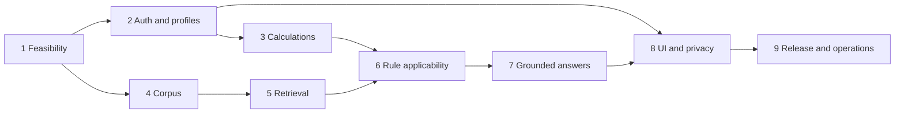

# Astrology Evidence Implementation Plan

> **Execution status:** The user approved implementation, and work was completed in `implementation/mvp` then merged to `main`. The checkboxes below describe the original ordered work plan and are not its completion ledger. See [implementation progress](../implementation/PROGRESS.md) and the [GPT-6.1 Sol handoff](../implementation/GPT-6.1-SOL-IMPLEMENTATION-ARTICLE.md) for completed tests, commits, and still-open launch gates. Steps use checkboxes as the original plan record.

**Goal:** Deliver a private-beta Python web application with reproducible Vedic charts and inspectable, source-backed interpretations.

**Architecture:** FastAPI modular monolith with server-rendered UI, PostgreSQL transactional storage/jobs, Qdrant retrieval and an offline ingestion worker. A bounded LangGraph workflow supplies verified facts and licensed excerpts to LangChain's Responses API adapter; LiteLLM remains optional.

**Tech Stack:** Python 3.12 baseline, uv, FastAPI, Jinja2, HTMX, Tailwind, PostgreSQL, SQLAlchemy/Alembic, Google OIDC/Authlib, Swiss Ephemeris adapter, Qdrant, multilingual-e5-small candidate, LangChain, LangGraph, pytest/Ruff/mypy.

**Spec:** [Product](01-product-and-scope.md), [architecture](03-architecture.md), [contracts](12-data-and-api-contracts.md). Read specialist documents referenced by each task. Proposed file layout is in [standards](14-code-standards-and-testing.md).

## Global constraints

- This was documentation-only until the user separately approved implementation on 2026-11-15; the plan is now an ordered historical execution outline. Current status is in [implementation progress](../implementation/PROGRESS.md).
- No credentials in source, fixtures, logs, docs or browser responses.
- Google sign-in and server-derived ownership govern every private resource.
- Vedic/sidereal/Lahiri/whole-sign/mean-node initial defaults; Gregorian births from 1900-01-01 through current date.
- Unknown birth time must not produce fabricated precision or time-dependent claims.
- Direct Responses route at the user-specified provider; no chat-completions fallback.
- At most two generation calls per question; 150-second total deadline; each provider call <=120 seconds and remaining budget.
- Only licensed, reviewed passages can be served; all displayed citations resolve to authorized exact spans.
- Public deployment blocked until source rights, ephemeris licensing, provider processing terms and hosting fit are resolved.
- No guarantee of future events; computed facts, traditional claims and model inference stay distinct.

## Review focus

1. Different users requesting the same object ID: no data or existence leakage. Tasks 2, 5 and 8 own tests.
2. DST fold/gap and unknown time near lunar/ascendant boundaries: clarify or withhold precise facts. Task 3 owns tests.
3. Withdrawn rights or deleted accounts after cached/saved readings: immediate serving denial and complete planned purge. Tasks 4, 8 and 9 own tests.
4. Provider timeout after receiving a request: no automatic duplicate charges or fabricated reading. Tasks 1 and 7 own tests.
5. Retrieved passage with correct keyword but missing prerequisites or malicious instructions: do not treat as applicable authority. Tasks 5–7 own tests.

## Sequencing

After shared contract definitions, corpus preparation and identity/calculation can proceed in parallel with separate file ownership. Domain review and rights acquisition may take longer than coding; do not invent a completion date. Each task follows its own failing-test, implementation, verification and review cycle. Commits are suggested implementation checkpoints, not actions performed by this plan.

## Task 1: Resolve feasibility and establish the first running slice

**Files:** future `pyproject.toml`, `uv.lock`, `src/astrology_evidence/config.py`, `main.py`, `answers/provider.py`, `tests/test_provider_contract.py`, `tests/test_health.py`; update decision and deployment documents.

**Interfaces:** `Settings` exposes typed provider, session, database and retrieval settings. `generate_response(request: GenerationRequest) -> GenerationResult` accepts minimized messages, remaining timeout and output budget; returns parsed content, reported model, request ID and usage if supplied. Types defined in `answers/contracts.py`, conforming to the contracts document.

- [ ] Record decisions on source-rights path, ephemeris license path and provider privacy constraints. Local engineering may continue where safe; no public release before gates clear.
- [ ] Write `test_responses_route_only`, asserting the configured client sends POST `/v1/responses` and never `/chat/completions`; add malformed output, 410/429, timeout and redaction cases. Use a local fake transport without a live secret.
- [ ] Run `uv run pytest tests/test_provider_contract.py -v`; expect failures for missing implementation, not unrelated environment errors.
- [ ] Create the minimum locked project, typed settings, provider adapter and live/ready endpoints. Use the exact requested model/base URL and `use_responses_api=True`, `timeout=120`, `max_retries=0`; do not assume every optional OpenAI parameter is accepted.
- [ ] Run provider and health tests; require all passing and confirm errors omit credentials. An opt-in real smoke test uses a newly supplied environment secret and a harmless short prompt; record actual response shape before enabling advanced features.
- [ ] Benchmark the selected local encoder's startup, peak/steady memory and one query on target hardware. Decide whether the free web tier can actually host it. Document a fallback deployment, not an unmeasured promise.
- [ ] Review, record results and checkpoint the slice. Do not introduce LiteLLM unless a native passthrough wire test demonstrates its value and compatibility.

## Task 2: Google authentication, sessions and private profile revisions

**Files:** `identity/contracts.py`, `identity/routes.py`, `identity/service.py`, `profiles/contracts.py`, `profiles/service.py`, `profiles/routes.py`, `db.py`, initial `migrations/`, `tests/test_auth.py`, `tests/test_profile_ownership.py`.

**Interfaces:** `require_user(session_token) -> UserContext`; `create_profile(owner: UserContext, birth: BirthInput) -> ProfileRevision`; `get_profile_revision(owner: UserContext, revision_id: UUID) -> ProfileRevision`. `UserContext` contains user ID and roles from the server; `BirthInput` follows the documented contract.

- [ ] Write auth tests for valid login, wrong state/nonce/audience, expired token, callback replay, session fixation and CSRF. Write profile tests where two users attempt each other's read/edit/delete.
- [ ] Run `uv run pytest tests/test_auth.py tests/test_profile_ownership.py -v`; confirm intended failures.
- [ ] Implement Google OIDC through a maintained library, server-side opaque sessions, ownership-scoped queries, CSRF and immutable profile revisions. Define issuer+subject uniqueness and enforce safe redirects.
- [ ] Run the same tests plus migration checks against disposable PostgreSQL; require zero cross-user access and correct logout/revocation. Include the canonical owned profile/chart GET routes, equal aliases across users, and server UTC current-date validation.
- [ ] Review schema and cookie behavior; record results and checkpoint.

## Task 3: Reproducible natal-chart calculation

**Files:** `profiles/places.py`, `tests/test_places.py`, `calculations/contracts.py`, `calculations/time.py`, `calculations/ephemeris.py`, `calculations/service.py`, `tests/test_birth_time.py`, `tests/test_chart_reference.py`, `tests/fixtures/charts/`.

Read [calculation algorithms and fixtures](22-calculation-algorithms-and-reference-tests.md) before this task; its CAL-01 through CAL-24 fixture classes are the detailed test inventory.

**Interfaces:** `resolve_birth_time(birth: BirthInput) -> ResolvedBirthInterval`; `calculate_chart(birth: ResolvedBirthInterval, settings: ChartSettings) -> ChartSnapshot`; snapshot includes stable/unavailable facts and full engine manifest.

- [ ] Implement and test the birthplace-resolution boundary defined in the domain document: explicit-submit search, confirmed coordinates, pinned timezone suggestions, historical uncertainty and manual fallback. Add `test_duplicate_city_names`, `test_geocoder_timeout_manual_fallback`, `test_timezone_border_requires_confirmation` and `test_place_lookup_excludes_birth_identifiers` before the implementation; run `uv run pytest tests/test_places.py -v` to see intended failures, then rerun after the minimal service is added.
- [ ] Assemble independently sourced, settings-matched fixtures with reviewer signoff and provenance; do not invent expected positions.
- [ ] Write tests for ordinary chart, DST fold/gap with multiple candidate instants, skipped dates, non-hour transitions, UTC date rollover, mean/true node separation, angular wrap, unknown-time house suppression, interval crossing Moon sign, ephemeris fallback warning and concurrent configuration isolation.
- [ ] Run `uv run pytest tests/test_birth_time.py tests/test_chart_reference.py -v`; confirm failures expose missing behavior.
- [ ] Implement timezone validation and isolated engine adapter. Preserve actual flags, data checksums and uncertainty. Cache by owner plus complete immutable input/settings/engine digest.
- [ ] Run tests; require <=1 arcsecond only on applicable matched-reference longitude fixtures and exact expected uncertainty behavior. Review independent comparison quality before marking calculations validated.
- [ ] Record verified capabilities and checkpoint. Dashas/D9/transits remain out of MVP.

## Task 4: Rights-cleared corpus and provenance-preserving ingestion

**Files:** `corpus/contracts.py`, `corpus/rights.py`, `corpus/extract.py`, `corpus/chunk.py`, `corpus/service.py`, `jobs/service.py`, `worker/main.py`, migrations, `tests/test_corpus.py`, `tests/test_job_recovery.py`.

Read the [expanded acquisition playbook](19-corpus-acquisition-and-editorial-playbook.md), [OCR quality dossier](25-ocr-and-multilingual-quality.md), and [database consistency design](30-postgres-jobs-and-consistency.md) before this task.

**Interfaces:** `register_edition(metadata: EditionInput, rights: RightsRecord) -> Edition`; `extract_passages(edition_id: UUID) -> list[PassageDraft]`; `publish_generation(generation_id: UUID) -> CorpusGeneration`. Human review transitions drafts to approved passages.

- [ ] Acquire permission/evidence for 3–5 pilot editions; select permitted sample pages and record edition identity, source artifact checksum and display permissions. If unavailable, use explicitly synthetic fixtures for engineering and keep real corpus release blocked.
- [ ] Write tests for absent rights rejection, OCR page/verse alignment, 448-token total cap, exception preservation across child chunks, separate translation attribution, duplicate job execution, worker restart and withdrawal during serving.
- [ ] Run `uv run pytest tests/test_corpus.py tests/test_job_recovery.py -v`; confirm intended failures.
- [ ] Implement immutable artifacts and passage records, extraction/OCR review, chunking, job leases and staged generation publication. Reject malformed imports and arbitrary external URL fetches.
- [ ] Re-run tests, manually review pilot passage fidelity, and verify a partial job cannot publish an incomplete generation.
- [ ] Record editorial review and rights evidence; checkpoint. Do not scale the corpus before retrieval evaluation.

## Task 5: Filtered hybrid retrieval and reproducible evaluation

**Files:** `retrieval/contracts.py`, `retrieval/embeddings.py`, `retrieval/search.py`, `retrieval/evaluation.py`, `tests/test_retrieval.py`, `tests/evaluation/`.

Read [retrieval experiments](24-retrieval-experiments-and-ranking.md), [evaluation design](27-evaluation-and-benchmark-design.md), and [Qdrant operations](31-qdrant-index-and-capacity.md) before this task.

**Interfaces:** `embed_query(text: str) -> vector`; `retrieve(request: RetrievalRequest) -> EvidenceBundle`; `evaluate_retrieval(dataset_id: str, config_id: str) -> EvaluationReport`. Vectors are 384-dimensional for the initial E5 revision; no mixed revisions in one collection.

- [ ] Curate the 150 reviewed questions and freeze the 100-question held-out split. Record passages, applicable conditions and acceptable abstentions.
- [ ] Write tests for query/passage prefixes, dense AND sparse rights filters, tradition filters, exact verse lookup, parent exceptions, empty evidence, source withdrawal and malicious passage content.
- [ ] Run `uv run pytest tests/test_retrieval.py -v`; confirm failure before implementation.
- [ ] Implement pinned tokenizer/embedding normalization, lexical sparse configuration validated in a focused spike, top-30 dense and top-30 sparse fusion, up to 8 selected passages and bounded parent expansion. Authoritative passage lookup rechecks rights.
- [ ] Run integration tests against disposable Qdrant and PostgreSQL, then dense/lexical/hybrid ablations on development questions. Freeze config before release evaluation; target Recall@10 >=0.90 with reported denominators.
- [ ] Record memory/latency and quality results; checkpoint. A failed multilingual benchmark limits advertised language support.

## Task 6: Rule applicability and inspectable claim validation

**Files:** `calculations/rules.py`, `answers/contracts.py`, `answers/validation.py`, `tests/test_rule_applicability.py`, `tests/test_citations.py`.

Read [claim-level evidence validation](26-evidence-validation-and-contradictions.md) before this task; exact source spans and all narrative fields must be validated.

**Interfaces:** `match_reviewed_rules(chart: ChartSnapshot, evidence: EvidenceBundle) -> RuleMatches`; `validate_answer(answer: ReadingAnswer, chart: ChartSnapshot, evidence: EvidenceBundle) -> ValidationResult` with accepted claims and structured violations.

- [ ] Write tests where keywords match but required houses/time are absent, an exception defeats a rule, schools disagree, citation ID is fabricated, quotation altered, or source text requests tool execution.
- [ ] Run `uv run pytest tests/test_rule_applicability.py tests/test_citations.py -v`; confirm intended failures.
- [ ] Implement explicit reviewed predicates and structural citation/fact checks; unsupported applicability is labeled model inference. Quotation matching uses stored exact source spans, not normalized search text.
- [ ] Run tests and have domain reviewers adjudicate semantic-support examples; require zero fabricated quotes/IDs in the suite.
- [ ] Record reviewed rules and unresolved commentary; checkpoint.

## Task 7: Bounded grounded-answer workflow

**Files:** `answers/workflow.py`, `answers/prompts.py`, `answers/service.py`, `answers/routes.py`, `tests/test_answer_workflow.py`, reading migrations.

**Interfaces:** `create_reading(owner: UserContext, request: ReadingInput, idempotency_key: str) -> ReadingRequestResult`; `ReadingInput` holds profile revision, question and settings. `ReadingRequestResult` contains request state and completed reading reference if available. Use Tasks 1, 3, 5 and 6 contracts.

- [ ] Write tests for insufficient evidence, contradictory sources, invalid output, consent decline, timeout after send, same-key replay, changed-payload key conflict, total-deadline exhaustion and at most one repair.
- [ ] Run `uv run pytest tests/test_answer_workflow.py -v`; confirm intended failures.
- [ ] Implement fixed workflow nodes, minimized prompt context, bounded provider calls, validated persistence and safe failure states. Store exact manifests and no hidden chain-of-thought.
- [ ] Run unit/integration tests and frozen grounding evaluations; target >=95% reviewed claim support and >=95% abstention recall. Report sample sizes and review disagreement.
- [ ] Review provider data handling and logs; record evidence and checkpoint.

## Task 8: Complete UI, citations and privacy flows

**Files:** `web/routes.py`, `web/templates/`, `web/static/`, `identity/deletion.py`, `jobs/export.py`, `tests/browser/`, `tests/test_deletion.py`.

Read [detailed interactions](21-ui-interaction-specification.md), [threat model](28-security-threat-model.md), and [privacy lifecycle](29-privacy-and-data-lifecycle.md) before this task.

**Interfaces:** UI consumes the existing service contracts; it does not duplicate calculation or authorization. `request_account_deletion(owner: UserContext) -> DeletionJob`; `request_export(owner: UserContext) -> ExportJob` returns an authenticated expiring result.

- [ ] Write browser tests for Google callback simulation, consent decline, unknown-time profile, chart table, cited answer, disagreement, provider error, keyboard navigation, logout and deletion; add unauthorized fragment/export access tests.
- [ ] Run the configured browser and deletion tests and confirm expected failures.
- [ ] Implement routes, templates, design tokens, chart SVG/table, exact excerpt cards and accessible error states. Support ordinary form submission as well as enhanced updates.
- [ ] Implement export and deletion across profile/reading/session/job data, caches and future checkpoints; document backup expiration and restore-time deletion replay.
- [ ] Run browser, ownership, deletion and manual accessibility checks. Exercise request cancellation, job status and authenticated export download endpoints, including410 after export expiry and deletion races. Verify raw questions/birth details are absent from URLs, analytics and logs.
- [ ] Record findings and checkpoint. Product acceptance requires a human review of one complete reading, including every source.

## Task 9: Deploy a measured beta and prove recovery

**Files:** future deployment manifests/container file, CI configuration, backup/restore runbooks and `tests/test_operations.py`; update [deployment](10-deployment-and-costs.md) and [progress](16-progress-and-open-decisions.md).

Read [host comparison](34-hosting-options-and-budget-model.md), [operational runbooks](35-observability-and-incident-runbooks.md), and [CI/release strategy](37-ci-testing-and-release-strategy.md) before this task.

**Interfaces:** deployment exposes live/ready endpoints, injects secrets server-side, runs schema migrations as a controlled job and supplies persistent external storage. Worker runs the same application package with restricted service permissions.

- [ ] Write operational checks for ephemeral-disk restart, database restore, Qdrant rebuild, rights withdrawal, session revocation and deletion replay after restoring backups.
- [ ] Run checks against a disposable environment; confirm meaningful failures before adding missing operations behavior.
- [ ] Provision only after the user requests deployment; validate actual quotas/prices at that time. Configure exact Google redirect URI, TLS, secrets, backups, rate limits and provider budget ceiling.
- [ ] Prove the privacy-job executor works while the web service sleeps and the ingestion workstation is offline; otherwise restrict the demo to synthetic records. A real-user beta requires the reliable executor described in the deployment document.
- [ ] Run cold-start/RAM/load measurements and full release gates. A free-tier out-of-memory failure requires moving compute or reducing scope, not removing security or silently using remote embeddings.
- [ ] Restore a backup and rebuild the index in staging. Confirm deletion and rights records are replayed before restored data serves traffic.
- [ ] Record pass/fail evidence, known limits and rollback steps. Launch only after launch blockers are resolved; implementation completion is not predictive-science validation.

## Definition of done

Every MVP requirement maps to a tested task; no launch blocker is open; calculations and citations have independently reviewed evidence; all core UI flows work; the operator can restore and delete data; hosting/resource claims are measured; no exposed secret is in repository history. Mark actual progress with evidence only. A design-complete checkbox is never an application-complete checkbox.
