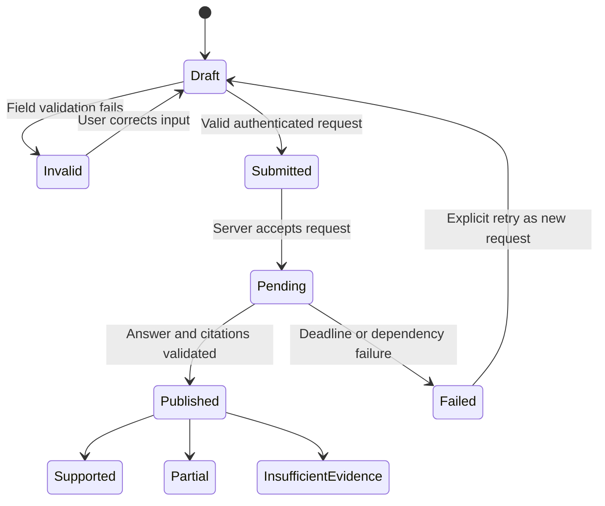

# UI interaction specification

Status: implementation specification prepared 2026-11-15 and partially realized in the current UI. Extends [09 UI overview](09-ui-and-user-flows.md) and uses [12 API/data contracts](12-data-and-api-contracts.md) as the canonical schema. English, adult private beta, Vedic D1 natal scope. A synthetic browser flow has been exercised, but this specification still contains unimplemented interactions and unverified accessibility criteria. Numerical limits below remain requirements that must be synchronized with server validation; browser validation alone is insufficient.

November 16 scope override: authentication is future work, disabled by default. Use automatic separate anonymous browser workspaces in the current UI; no login/logout step or Google prompts. Interpret owner checks below as server-derived browser-session ownership. See [the current guest/UI plan](46-anonymous-workspace-and-ui-plan.md) and [public-site research](45-ui-refresh-research.md) for the six-section navigation and refresh criteria. Historical Google-specific acceptance cases remain tests for the retained optional future mode.

## Interaction model and invariants

Render pages with FastAPI/Jinja2, enhance forms with a small fetch script, use application CSS, and keep normal navigation/forms usable, matching implemented ADR-02. The server owns authentication, resource permissions, input normalization, job state and citation verification. The browser never computes authoritative planetary placements or decides that a passage supports a claim. Small client scripts may manage focus, disclosure panels and chart presentation; they cannot substitute for service validation.

MVP requires an explicitly consented saved birth profile before a personalized chart. A session-only profile is deferred because it needs separate lifecycle and storage contracts. Declining external-model processing still allows authorized chart and library use. A synthetic public demonstration has no real profile submission. Free hosting must not promise real-user deletion schedules without a reliable job executor; the deployment document decides when a real-user beta is enabled.

The page title, heading and navigation identify the current task. Full-page and fragment requests use the same service permissions. The UI uses `ReadingAnswer.status` values supported, partial and insufficient_evidence; these describe textual support, not future-event probabilities. Chart revisions and completed readings are immutable. Changing an input creates a new revision and explicitly new result.

## Screen 1: introduction, example and sign-in

The public page explains the four visible ingredients: your confirmed input, calculated chart, attributed traditional passage, and generated interpretation. Use a synthetic example with a conspicuous “Example, not your reading” label. Do not animate invented retrieval activity or show a fake personal result before login. A short corpus coverage note explains that the library is curated and incomplete.

“Continue with Google” starts the server OIDC route `/auth/google/start`. Google cancellation returns to sign-in with a neutral message and retry. State expiration or replay creates no session; never display success simply because the callback URL loaded. The return location must be an allowed internal route. Logout is a CSRF-protected POST, not a GET link that a crawler could trigger.

On first authenticated access, present privacy notices with separate purposes: storing a profile and sending the minimum necessary question/chart data to the configured model provider. Neither choice is preselected. Explain that questions can themselves contain identifying information. Declining profile storage offers library navigation; declining model processing offers chart/library use. Consent records include notice versions. Changed provider processing terms require renewed consent before further external requests, not a silent settings update.

## Screen 2: profile creation and revision

Fields have persistent labels and descriptive errors, not placeholders as labels. Display only fields necessary for the chosen precision. Alias is optional, trimmed, at most 80 characters; it is never sent to the model by default. Birth date is required and Gregorian, from 1900-01-01 through the current date. The service determines its supported current-date boundary consistently; the UI must not accept a future date because the browser timezone differs.

Time precision is an explicit enum: exact, approximate or unknown. Exact requires a local time to minute precision, clearly showing 24-hour format or explicit AM/PM. Approximate requires an ordered earliest/latest interval; cross-midnight intervals need date-qualified endpoints rather than an unexplained end time preceding start time. For the first slice, restrict the interval to the entered local birth date and show a correction message if the user needs a wider range. Unknown has no hidden noon value and maps to the whole local day.

Birthplace search occurs only after explicit form submission and shows city, region and country; never send keystroke autocomplete to public Nominatim. The optional provider must first pass operator policy review. Manual coordinates/timezone remain available when external search is disabled. Selecting a result displays its resolved coordinates and timezone for confirmation. Typing a place name without selecting or manually confirming it is not a resolved location. Manual latitude must be between -90 and 90 and longitude between -180 and 180; a timezone must be a supported IANA identifier. Client and service reject nonfinite values. Coordinate precision describes the input, not certainty that the historical birthplace is known to that precision.

Repeated local time shows two offset-labelled alternatives; neither is automatically selected. A nonexistent local time explains the clock change and asks for a corrected time. Unknown historical-zone resolution blocks exact claims and shows a limitation. If geocoding fails, retain typed values and offer manual entry. Do not request current GPS permission for birthplace.

Before saving, show a review summary with date, precision, interval, place, zone/offset status, and the fixed supported method: Jyotish, sidereal Lahiri, whole-sign houses, mean nodes. Unsupported settings are explanatory text, not selectable controls. Save creates a profile revision and returns a clear success state. Editing a stale revision receives 409 and offers reload/compare; it never silently overwrites another tab's changes.

## Screen 3: chart and uncertainty inspection

A chart page identifies profile revision, calculation time, method, engine/data versions and unavailable factors. The visual D1 chart has an adjacent table with body, longitude/sign, motion when supported, stability and availability. Screen readers receive the same information without interpreting glyphs. Planet symbols always have names. The graphic is generated from validated facts and escaped application templates, never from model markup.

Unknown-time charts suppress ascendant and houses. Stable planetary signs may appear only when the engine has checked relevant crossings over the interval. A Moon placement that changes across the interval appears as alternatives with the interval explanation, not as a single definitive label. The UI distinguishes unavailable, unstable and stable; none is expressed only by color.

“Compare input uncertainty” presents two existing snapshots or an explicit new calculation request. It lists the changed input, stable facts, changed facts and newly unavailable facts. It does not average two charts into a fictitious middle result. Changes to display style do not recompute the chart; changes to a supported method or input create a new version. D9, dashas, transits, compatibility and birth-time rectification are labelled outside the MVP and are not offered as functioning buttons.

## Screen 4: question submission and progress

The workspace shows selected profile revision, concise uncertainty status and chart method above the composer. Require a nonblank question; proposed maximum is 2,000 characters, counted consistently server-side. Trim outer whitespace, preserve meaningful punctuation and do not rewrite the user's question without showing the edit. Provide examples about supported natal themes rather than guaranteed event dates. Do not ask for caste, religion or gender to improve a generic interpretation.

Submitting creates an idempotency key tied to the exact request body. The button becomes busy and announces progress; double-clicks and network retries reuse that request. If the same key is accidentally used for different content, show the 409 recovery rather than silently choosing one question. One active answer per user is the initial shared-store rule; additional submission is disabled with an explanation. A browser refresh resumes authorized status from `/api/reading-requests/{id}`.

Progress states are received from the server and describe actual work: calculating, finding sources, drafting, verifying, completed or failed. Avoid fabricated percentages and unexplained indefinite spinners. A timeout preserves the question and chart and clearly says no completed answer was published. If provider execution may have occurred, a new call requires deliberate retry and a new request; no automatic duplicate call. Cancellation UI is deferred until a server cancellation contract exists; closing the tab is not represented as stopping billed work.

Do not stream unverified interpretation text. The first release publishes the structured answer after citation validation. Progress can update while content remains withheld. Chart facts and library access remain available during a model failure.

## Screen 5: answer and evidence explorer

Show concise summary first, followed by computed facts, attributed traditional claims, AI interpretation, disagreements and limitations. These labels map directly to contract fields; the renderer does not infer evidence class from prose. A traditional claim includes its source markers and relevant chart-fact links. Applicability status `reviewed_rule` means the reviewed predicate was checked; `model_inference` is presented as interpretation; `not_established` cannot look like a confirmed application.

Opening a citation shows work title, author attribution, edition, translator/editor, language, chapter/verse if available, printed page and scan page when different, and exact permitted text. It shows the supporting span without inventing a verse number to fill an empty field. Machine-assisted translation is labelled. Where source text cannot legally be reproduced, display permitted metadata and an unavailable-excerpt explanation. The UI cannot bypass read-time rights checks using a previously cached fragment.

Desktop may use a side drawer; mobile uses a full-width panel or page. Opening moves focus to its heading; Escape closes a modal drawer; closing restores focus to the invoking citation. A nonmodal desktop panel must not trap focus. A full-page citation has a back link preserving the reading and selected claim. Long quotations wrap; horizontal scrolling is reserved for genuinely tabular material. Source text is selectable and copyable only within the approved excerpt policy.

“Why this applies” shows chart conditions and reviewed rule prerequisites, then the actual source passage and exceptions. It is an explanation of evidence, not hidden model chain-of-thought. “Disagreement” shows competing passages with school/edition labels and differing conditions. It must not declare a majority vote across copied editions to be independent confirmation. Retrieval scores are internal ranking information and never become percentages of marriage, illness, wealth or other outcomes.

An insufficient-evidence response is a successful, honest product state: name the unsupported part, show any relevant authorized material and suggest a narrower question. A partial answer visually separates supported material from the limitation. Report-citation feedback offers wrong passage, unsupported interpretation, translation/OCR issue and other, with an optional 1,000-character comment. Feedback is linked to the owned reading and does not treat user agreement as proof of accuracy.

## Screens 6–8: library, history and account

Library search works independently of personal questions. Results show edition, passage locator, language, reviewed status and a short permitted excerpt. Search is scoped to published shared material and active rights; unavailable unpublished records are not discoverable to ordinary users. Empty results explain coverage. Bibliography candidates are not counted as searchable books. The edition page lists source/translation provenance, coverage limits and last review without presenting unfinished OCR as authoritative text.

History lists date, short question, profile alias/revision and answer status. The initial screen avoids showing long sensitive question text in shared-screen contexts. Opening an old reading preserves its original chart/model/corpus manifest. If a source is withdrawn, its excerpt is removed or replaced according to rights rules, with a visible explanation; the reading must not imply the source remains available. Deleting a reading requires confirmation of the actual object, not reauthentication for every harmless action.

Settings separates display preferences from privacy operations. Display controls include system/light/dark theme, 12/24-hour presentation, text size and answer detail. English is the enabled answer language; original-script excerpts do not imply full multilingual support. Exports are authenticated jobs with expiry and status, not public permanent links. They include own profiles/readings and permitted source references, not whole copyrighted books.

Profile deletion explains affected charts/readings. Account deletion immediately revokes access and starts the documented purge; show the 24-hour active-data target and 30-day backup-expiry target only on a deployment that can fulfill them. Provider retention limitations remain explicit. A minimal deletion receipt/status mechanism must not require a session that has just been revoked or expose deleted data; its exact secure contract belongs to the deletion service specification before implementation.

## Screen 9: curator edition review

Curators see a separate authorized navigation section. An ordinary signed-in account receives the same nondisclosing denial for direct admin routes and their fragments. The queue separates submitted, rights review, text review, ready, publishing, published, failed and withdrawn presentation states; these must map to defined service states before implementation. A curator cannot mark rights approved merely by uploading a public URL.

The edition form captures work attribution, translator/editor, publisher/year where known, language, artifact checksum, rights evidence, jurisdictions, expiry and excerpt policy. Required omissions block publication and name the missing field. The OCR review view places page image and extracted passage together with printed/scan page coordinates, uncertain characters and translation alignment. Correcting text creates a new passage version/checksum and marks dependent review as stale.

Publication requires approved rights, reviewed material and completed indexing/count checks. The button starts a job and reports its generation; it does not immediately claim the corpus is live. Withdrawal immediately stops serving and retrieval eligibility, then tracks cache/index purge. Failed indexing offers an idempotent retry only for retryable errors. Rights expiration is not recoverable by retrying. Preview shows exactly what an ordinary reader is permitted to see, not curator-only source files.

## Component configuration and accessibility

| Component/setting | Proposed default | Invariant or acceptance condition |
|---|---|---|
| Reading measure | 72 characters | Long prose remains readable at zoom |
| Body type | 16px, line-height 1.6 | Honors browser text enlargement |
| Interactive targets | At least 44×44px design target | No overlapping hit areas |
| Responsive widths | 320px minimum; 640/1024px layout breaks | No clipped primary actions |
| Focus | Visible high-contrast outline | Never removed for aesthetics |
| Status announcements | Polite live region | No repeated announcement on every poll |
| Source drawer | Inline/side panel desktop, full-width mobile | Escape/back and focus restoration work |
| Date/time | Explicit Gregorian and timezone labels | No ambiguous numeric dates or offsets |
| Error summary | Above form, links to invalid fields | Values retained after recoverable failure |
| Color | Tokens from document 09 | Contrast measured before release |
| Motion | Minimal; reduced-motion respected | No essential meaning depends on animation |
| Question/comment limits | 2,000 / 1,000 characters | Identical server enforcement |
| Alias | Optional, 80 characters maximum | Never required for calculation |
| Theme assets | Locally served compiled styles/fonts | No runtime secret/config leakage |

Target WCAG 2.2 AA using semantic headings, landmark regions, explicit labels, visible focus, accessible validation, reflow and chart alternatives. Automated checks are necessary but insufficient; manually test keyboard and at least one screen reader. Background updates must not steal focus. HTMX swaps must preserve accessible names and update document title when navigation changes. Render retrieved/model text as escaped text or a restricted sanitized format; never allow active HTML from the corpus.

## Release acceptance scenarios

1. **Unknown time:** submit a valid date/place with unknown precision. No hidden noon appears; houses/ascendant are unavailable, and unstable placements show alternatives or abstention.
2. **DST ambiguity:** enter a repeated local time. Submission remains blocked until an offset occurrence is selected; summary and manifest agree.
3. **Two-tab edit:** save one profile revision in tab A, then stale changes in tab B. B receives a visible conflict with retained draft and no silent overwrite.
4. **Ownership:** user B requests user A's reading, job, chart, fragment and export. Each is denied without leaking question, alias or resource existence.
5. **Double submit:** two identical submissions with one key create one request. Different content with that key yields conflict; no second provider call occurs automatically.
6. **Provider timeout:** chart remains accessible, answer is not marked complete, question survives, and retry is explicit.
7. **Citation mismatch:** a generated quote differing from the authorized span fails the publication gate; no verified-looking source card appears for it.
8. **Withdrawal:** withdraw an edition while an old reading is open. A subsequent source fetch cannot reveal the withdrawn excerpt through HTML, API or cache.
9. **Keyboard evidence flow:** navigate from a claim to its passage and back using keyboard alone with correct focus restoration and no trap.
10. **Mobile and zoom:** at 320px width and 200% zoom, composer, evidence controls and deletion confirmation remain readable and operable.
11. **Consent refusal:** declining provider processing blocks generation while retaining allowed saved-chart/library access; no external model request is sent.
12. **Admin rights failure:** an edition missing excerpt permission cannot publish. Ordinary users cannot access its preview or source artifact.
13. **Deletion:** account deletion revokes active sessions and hides all owned resources; job/backup handling meets the deployment's stated policy.
14. **Comprehension:** prototype users can distinguish calculation, attributed rule and AI synthesis without interpreting support status as outcome probability.

These scenarios belong in the implementation test plan and release evidence, not a claim that the current documentation passes them. Related official references: [FastAPI templates](https://fastapi.tiangolo.com/advanced/templates/), [HTMX progressive enhancement](https://htmx.org/docs/), [WCAG 2.2](https://www.w3.org/TR/WCAG22/), and [Google OpenID Connect](https://developers.google.com/identity/openid-connect/openid-connect), directly retrieved during the earlier research pass on 2026-11-15.
