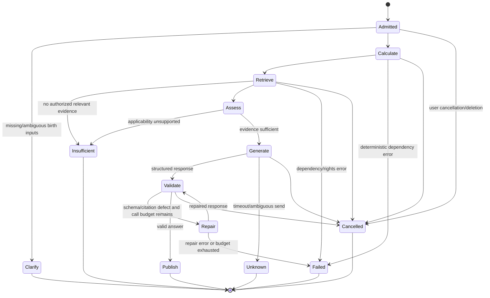

# Workflow state and failure design

Prepared 2026-11-15. This document defines the bounded answer workflow for Astrology Evidence. It is a design and research record; no workflow code or execution result is implied.

## Purpose and boundaries

The public answering path is a fixed LangGraph workflow, not a Deep Agent or open-ended planner. The graph makes a small number of inspectable transitions: authorize the request, resolve chart facts, retrieve licensed evidence, assess sufficiency, generate one structured answer, validate it, optionally repair once, then publish or terminate. Python services own calculation, rights checks, persistence, quotas and side effects. The model receives minimized facts and evidence as data. It has no shell, browser, filesystem, crawler, payment or arbitrary database tool. Retrieved passages and user text are untrusted content and cannot alter orchestration instructions.

The workflow has one global deadline of 150 seconds. A provider call receives the lesser of 120 seconds and the remaining deadline. At most two generation calls are allowed: initial generation and one validation repair. There are no automatic provider retries. A missing or ambiguous provider response is recorded as unknown; a deliberate user retry creates a new request and reservation. This follows the existing request ledger, quota reservation and no-silent-replay decisions in documents 03, 12, 13 and 30.

## State model

The graph state is a typed, serializable request envelope. It should contain opaque `request_id`, `owner_id` only for server authorization, `execution_generation`, deadline and cancellation markers; normalized question hash and idempotency-key reference; profile-revision and chart-snapshot IDs; chart facts with fact IDs, values, stability, unavailable-fact reasons and calculation manifest; retrieval request and evidence bundle IDs; a compact claim ledger; generation-call count and provider request IDs; validation findings; terminal status and safe user-facing result.

Each fact and evidence item carries provenance rather than copied private context: chart fact ID, source passage ID, edition and coordinates, text checksum, rights/review state, retrieval generation, workflow/prompt/model revisions and applicability status. Birth name, email, raw coordinates and unnecessary history stay outside provider state. Question text and birth data are not placed in operational logs. Checkpoint payloads should contain references and bounded content, with retention and deletion rules aligned to readings and account purge.

Graph outcomes distinguish `supported`, `partial`, `insufficient_evidence`, `clarification_required`, `failed`, `unknown` and `cancelled`. These do not extend the ReadingAnswer enum: supported/partial/insufficient_evidence map to succeeded requests with that answer status; clarification maps to a failed request with a safe clarification code, and errors map to failed/unknown/cancelled request status. A terminal result is immutable. Every transition records an audit-safe event without raw prompts, secrets, source text or personal data. The owner is always derived from the authenticated request; a client-supplied owner ID is ignored.

## Graph and transitions

| Transition | Guard and action | Terminal meaning or recovery |
|---|---|---|
| admitted to calculate | Ownership, idempotency hash and quota reservation committed | Continue under fenced execution generation |
| admitted to clarify | Time precision, timezone or required field cannot support requested claim | Ask one focused clarification; no chart fabrication |
| admitted to cancelled | Cancellation/deletion committed before work | Release only safe, pre-send reservation amounts |
| calculate to retrieve | Immutable chart snapshot created | Pass fact IDs and settings manifest |
| calculate to failed | Calculation engine or version mismatch | Retry only by deliberate new request after diagnosis |
| retrieve to assess | Active corpus generation and rights checked | Persist evidence manifest |
| retrieve to insufficient | No relevant authorized passage | Explain missing evidence; no generation call |
| retrieve to failed | Qdrant/Postgres or rights authority unavailable | Fail closed for protected content |
| assess to generate | Reviewed rule/evidence applicability is adequate | Reserve remaining call allowance |
| assess to insufficient | Passages mention topic but do not support claim | Qualified abstention |
| generate to validate | Provider returns parseable structured output | Validate every claim, quote and fact reference |
| generate to unknown | Timeout, connection loss or uncertain acceptance | Retain conservative quota usage; never auto-replay |
| validate to repair | Only bounded, correctable defects; one call remains | Repair prompt includes validator findings, not hidden reasoning |
| validate to publish | Schema, citation spans, rights and ownership all pass | Atomic immutable Reading publication |
| validate to failed | Defect is unsafe, prohibited or budget exhausted | Safe error; a validated partial answer instead follows publish and request succeeded |
| any active to cancelled | Explicit cancellation/deletion wins fenced race | Late completion cannot publish |

## Durability, interrupts and side effects

LangGraph persistence is useful for thread-scoped checkpoints, interruption and fault tolerance. Official documentation describes checkpointers as graph-state snapshots keyed by `thread_id`; stores serve cross-thread application data. Production persistence requires a durable saver such as PostgresSaver; in-memory savers disappear on process restart. Checkpoint retention must be bounded because state can grow indefinitely. Sources: LangGraph Persistence, accessed 2026-11-15, https://docs.langchain.com/oss/python/langgraph/persistence.md; LangGraph Durable Execution, https://docs.langchain.com/oss/python/langgraph/durable-execution.md.

A checkpoint is an aid to resuming graph control state, not an authorization to repeat side effects. LangGraph interrupt documentation states that resuming an interrupt restarts the node from its beginning; code before the interrupt can run again. Therefore nodes containing provider calls, quota settlement, publication or external writes must be split so side effects occur behind an idempotent ledger admission, and the resume path first consults the ledger. An interrupt can request clarification or human review, but this public MVP uses clarification as a terminal response requiring a new request. No automatic replay follows a crash after a provider send.

Optional checkpointing should use a request-scoped thread ID that is opaque, short and bound to owner and request in the database. Checkpoint contents are subject to export, deletion and rights withdrawal. The database request ledger remains authoritative for execution generation, cancellation, deadline, call number, provider request ID and terminal publication. A stale checkpoint or worker cannot finalize because completion updates require the current fenced generation and unexpired deadline.

The current durable-execution URL redirected to Persistence during inspection; replay details were verified in the dedicated Checkpointers page. That page explicitly says replay re-executes later nodes, including LLM calls and API requests. Historical replay therefore requires a diagnostic mode with side effects disabled; checkpointing alone cannot prevent double billing. Source: https://docs.langchain.com/oss/python/langgraph/checkpointers.md, accessed 2026-11-15.

Side effects are ordered: admission transaction first; external calculation/retrieval/provider work second; publication transaction last. A provider response that arrives after rights withdrawal, account deletion, cancellation or deadline is discarded. Before returning evidence, the server rechecks current rights and hashes against the evidence manifest. A revoked passage may remain in a checkpoint or provider transcript but must not be served; stored excerpt copies are removed according to the rights policy.

## Retry, structure and prompt safety

LangChain’s `RunnableRetry` and `.with_retry()` can retry runnables, but its reference recommends keeping retry scope small. This workflow applies retry only to local, deterministic parsing or explicitly classified idempotent storage operations. It does not wrap the provider generation runnable because a timeout may follow an accepted billable request. Source: LangChain RunnableRetry reference, accessed 2026-11-15, https://reference.langchain.com/python/langchain-core/runnables/retry/RunnableRetry.

Structured output uses a schema validated server-side. LangChain documents provider-native `ProviderStrategy` when supported and `ToolStrategy` otherwise; the selected strategy must be contract-tested against the configured Responses-compatible provider. The public workflow invokes the model adapter directly: it does not adopt an agent loop or automatic ToolStrategy fallback. Prefer provider-native schema support only after wire tests; otherwise request JSON and validate locally, with the same single repair budget. Disable schema-handler/model/SDK retries and reject unexpected tool calls. No provider-side function calling is needed. The schema carries status, summary, computed facts, traditional claims, interpretation, disagreements, limitations and evidence manifest. Server validation checks citation existence, exact permitted quote spans, chart fact IDs, applicability labels, prohibited claims and rights state. Source: LangChain structured output, accessed 2026-11-15, https://docs.langchain.com/oss/python/langchain/structured-output.md.

Repair is a narrow second generation call. The repair prompt includes only the original bounded input, validator error codes and permissible evidence references. It must never ask the model to reveal hidden reasoning or treat validator text as executable instructions. Prompt injection tests place instructions inside user questions, retrieved passages, translator notes and malformed citation fields; all are treated as data. A repair cannot introduce a new passage, chart fact, tradition or source coordinate absent from the original authorized bundle.

## Admission, budgets and memory

Admission locks global and owner quota buckets in a stable order and reserves allowance for both possible generation calls. Duplicate idempotency submissions return the existing request without another reservation. A changed request under the same key is a conflict. Budget accounting uses remaining wall time, a hard two-call counter and conservative provider allowance when usage is missing. The 150-second deadline includes retrieval, validation and repair; repair cannot reset it. Context is capped at the proposed 6,000 generation-token equivalent and output at 1,800 tokens, subject to provider compatibility tests.

Per-owner memory is limited to the current request plus explicitly selected saved readings. No global semantic memory of personal readings is available to the model. Checkpoints and traces are redacted and bounded; retention is shorter than canonical reading retention where practical. Cancellation closes database sessions and releases connections; a heartbeat or worker task never shares a mutable request session.

## Failure-injection suite

Before implementation claims completion, test at least these cases: duplicate admission; same key with changed question; two workers racing one request; lease expiry and stale completion; crash before and after provider send; dropped provider response; missing usage; deadline during repair; cancellation during each active node; rights withdrawal during generation; account deletion during publication; stale checkpoint resume; interrupt replay of pre-interrupt code; malformed structured output; invalid citation ID or quote span; prompt injection in passage text; unsupported birth-time precision; retrieval generation withdrawal; database serialization failure; and provider schema incompatibility. Expected outcomes are deterministic terminal states, no duplicate application admission or publication, no automatic resend after uncertain acceptance, conservative quota settlement, and no unauthorized excerpt exposure.

This design keeps the graph inspectable and bounded while allowing durable control-state recovery. It does not claim exactly-once execution for external providers; it makes uncertainty explicit and requires a deliberate new request whenever exactly-once behavior cannot be proven.

## Primary sources inspected

- LangGraph Workflows and Agents, accessed 2026-11-15: https://docs.langchain.com/oss/python/langgraph/workflows-agents
- LangGraph Persistence, accessed 2026-11-15: https://docs.langchain.com/oss/python/langgraph/persistence.md
- LangGraph Interrupts, accessed 2026-11-15: https://docs.langchain.com/oss/python/langgraph/interrupts.md
- LangGraph Checkpointers, accessed 2026-11-15: https://docs.langchain.com/oss/python/langgraph/checkpointers.md
- LangGraph Durable Execution (redirects to Persistence), accessed 2026-11-15: https://docs.langchain.com/oss/python/langgraph/durable-execution.md
- LangChain Structured Output, accessed 2026-11-15: https://docs.langchain.com/oss/python/langchain/structured-output.md
- LangChain RunnableRetry reference, accessed 2026-11-15: https://reference.langchain.com/python/langchain-core/runnables/retry/RunnableRetry

Deadline exhaustion is not user cancellation: classify it as failed with deadline_exceeded when no external result is uncertain, or unknown when a provider send may still be processing. Both fence publication. Canonical request/answer mappings and cancellation endpoints are in document12.
