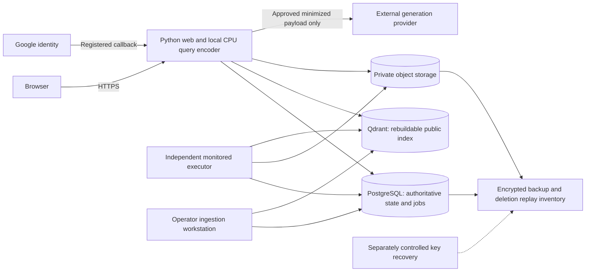

# Hosting options and budget model

Prepared 2026-11-15. Research and proposed deployment gates only: no account, paid resource, application, benchmark or deployment was created. Read with documents 10, 29, 30, 31 and 43. Prices below are observed USD list-price inputs, excluding taxes; refresh them in the actual account before purchase. Free allowances, trials and promotional credits are different instruments, and none establishes permanent free operation.

## Recommended operating modes

| Mode | Proposed arrangement | Entry gate |
|---|---|---|
| Full local development | Workstation runs Python web, encoder, PostgreSQL, Qdrant and worker; local private artifacts plus separate backup | Synthetic profiles, licensed sample passages; hardware measurements pending |
| Hosted synthetic demonstration | Candidate Render free web + Neon Free + Qdrant Free; attended local ingestion | Encoder and network tests pass; no real birth records; accept sleep and quota outages |
| Real-user private beta | Funded web capacity and independently available privacy executor; durable database, private objects and tested backups | Demonstrate deletion while web and ingestion workstation are stopped; provider review before personal AI requests |
| Paid production | Measured web/worker capacity, managed database, appropriately replicated Qdrant, private object storage and monitoring | Restore, security, rights, license, region and spending gates pass; owner accepts operating responsibilities |

Local means local application computation; an enabled external generator still receives approved inputs. A workstation is not an availability guarantee. If the encoder cannot run within a free host's limit, keep the full demonstration local or fund compute. Do not silently replace semantic retrieval with a static mock and describe the full system as hosted.

## Seven substantive service options

**1. Render: closest hosted web shape.** Its free Python web services sleep after 15 minutes without inbound traffic; the workspace receives 750 free instance-hours monthly. Filesystem changes disappear on restart, redeploy or sleep, and a persistent disk cannot attach to a free web service. Free PostgreSQL expires after 30 days. Other service types do not support free instances, so an independent free background worker is not established. Render documents managed TLS and custom domains. This supports an expendable synthetic demo, with Neon as the candidate database. [H1] The pricing page loaded but did not expose usable compute tables in this research fetch: current RAM, paid worker price and selected tier remain verification targets, not guessed figures. [H2]

**2. Neon: transactional authority, separately metered.** The current Free page lists 100 CU-hours monthly per project, 1 GB database storage, 5 GB public transfer and scale-to-zero after five inactive minutes. Its short free restore window is up to six hours or 1 GB of changes. Launch lists $0.106/CU-hour and $0.35/GB-month database storage; history, snapshots and overage transfer are separate. The advertised typical spend is not this application's quote. [H3] Polling the jobs table may prevent inactivity and consume compute; measure executor polling rather than assuming a mostly idle website means an idle database. A free allowance is not a substitute for independent encrypted exports and recovery evidence.

**3. Qdrant Cloud: retain the required retrieval service.** Free clusters have 1 GB RAM, 0.5 vCPU, 4 GB disk and one node, without dedicated resources. They use manual snapshot/restore APIs, incur upgrade downtime, suspend after a week unused and can be deleted after four weeks inactivity. Standard offers dedicated resources, backup/disaster recovery and multi-node configurations; an actual sized quote remains pending. [H4] Choose Free only for rebuildable demo indexes. Marketing vector counts do not establish fit for multilingual dense/sparse search, payload indexes, concurrent generations and optimizer peaks. Follow document 31's measurements; preserve canonical passages, model revisions and manifests outside the cluster.

**4. Hugging Face Spaces: useful experiment, awkward application host.** The inspected overview distinguishes CPU Basic's zero hourly hardware charge from creation eligibility: ordinary Docker/Gradio compute Spaces require a paid account plan, with a limited ZeroGPU exception for qualifying personal accounts. CPU Basic lists 2 vCPU, 16 GB RAM and 50 GB nonpersistent disk; unused free hardware sleeps. Outbound ports are restricted to 80, 443 and 8080. [H5] Consequently normal PostgreSQL connections on 5432 fail the proposed network shape; Qdrant REST on 443 is possible, but that does not solve database connectivity. A supported HTTP database adapter would require fresh transaction/job compatibility evidence. Prefer Spaces for synthetic encoder demonstrations; do not call it a zero-cash drop-in production deployment.

**5. Railway: metered Python container alternative.** Its Free plan lists $1 monthly credit and 0.5 GB maximum RAM per service. Hobby costs $5/month including $5 usage; the subscription is a floor, not an additional $5 on every usage dollar. Container rates list $10/GB-month RAM, $20/vCPU-month CPU, $0.05/GB egress and $0.15/GB-month volumes. The separate VM rates must not be substituted for these container prices. Free/trial volume data has a documented deletion schedule after expiry. [H6] Trial credits are separately described in H7. This is a candidate paid web/worker platform, conditional on measured encoder memory, worker execution and persistent-store recovery; the tiny monthly free credit does not establish continuous operation.

**6. Fly.io: controllable machines with explicit resource costs.** The inspected pricing table quotes always-running 30-day Machines in its lowest-priced regions: shared 1 GB RAM at $6.70 and shared 2 GB RAM/two CPUs at $13.39. Regional variation, running seconds, stopped-root-filesystem charges, volumes, snapshots and transfer affect the invoice. Volumes list $0.15/GB-month and snapshots $0.08/GB-month beyond the included amount. [H8] These are resource prices, not an application fit or uptime claim. Budget separate web and worker capacity, and verify restart, sleep/autostop settings and network behavior. No ongoing free entitlement is assumed.

**7. Cloudflare Pages/Workers: static surface or separately validated redesign.** Pages Functions use the Workers runtime. Python Workers now support pure Python, PyEmscripten packages and packages included with Pyodide; this is not an unrestricted Linux Python environment. [H9,H10] A Python build step on a static site does not establish runtime support for the FastAPI/native ephemeris/encoder stack. Keep Pages an optional documentation/landing-page host. Moving the actual application here requires proving native dependency compatibility, memory, request duration, database transactions and reliable job execution; it is outside the proposed deployment default.

Supabase was not investigated as an eighth option: replacing the existing PostgreSQL/auth/storage choices would need its own operational comparison, while Qdrant remains required. No quota or price is asserted for it.

## Deployment boundaries and failure gates

Proposed release gates are operational evidence, not vendor promises:

- Pin E5 revision/runtime and benchmark cold model download/load, peak resident memory, steady memory, warm/cold p95 latency, concurrency and image size. The model card establishes 384-dimensional embeddings and a 512-token limit, not host RAM consumption. [H11] Require combined peak below the document 10 target of 75% of host memory; assess each process's duplicate encoder. OCR and bulk embeddings stay off the request path.
- Prove queued privacy jobs finish within the proposed 24-hour target with web and workstation stopped. Stale executor heartbeat disables new profile collection and exports; synchronous deletion denial remains effective. Retries cannot postpone the original deadline. Database polling cost and scheduler failure alerts belong in the test.
- Record selected regions for application, database, index, objects, backups and generation provider. Co-location is a latency/egress goal, not proof of jurisdictional acceptability; cross-provider traffic can still be billable. Test allowed ports and TLS from the actual host.
- Configure separate staging/production Google clients and exact registered callback URLs; Google requires redirect matching. [H12] Test secure cookies, proxy origin handling, cold-start login and expiry. Preview domains cannot inherit unrestricted callbacks.
- Restore database and artifacts into isolation, replay deletion/rights tombstones, invalidate restored sessions and verify denial before reopening. Keep recoverable encryption-key versions separately controlled and test key recovery. Expire all backups/object versions within document 29's 30-day maximum; reconcile this with document 10's weekly-copy schedule.

A self-managed VPS is an operational variant, not a researched eighth vendor quote. It can run the same components, but the operator must patch the OS, restrict ports, renew TLS, supervise workers, monitor disk and OOM events, rotate secrets, maintain off-machine object/backup storage and conduct restores. Putting database, index, web and backups on one disk creates a common failure domain. Price operator time and incident recovery explicitly; a cheap VM does not establish a cheaper reliable service.

## Budget equation and illustrative sensitivity

Use monthly total `C = web + worker + database + Qdrant + objects + backup + egress + observability + domain + generation + optional geocoding + tax`. Add operator hours separately. For metered services, calculate each consumed unit multiplied by its verified rate, apply included allowances once, then add subscription floors/other fees. Reserve rebuild disk and temporary duplicate corpus generations.

Generation is `Q × (mean_input_tokens × input_rate + mean_output_tokens × output_rate) / 1,000,000`, plus measured repair/failed-request charges where applicable. FreeGG's rates, availability, privacy and quotas remain unknown; denote its total `G_unknown`, never zero. Enforce conservative request reservations even when usage fields are missing, and preserve the two-call/overall deadline limits in document 43.

**Illustration A, not a quote:** suppose combined Railway containers average 1.5 GB RAM and 0.1 vCPU for a billing month, with 2 GB volume and 10 GB egress. H6 arithmetic gives `15 + 2 + 0.30 + 0.50 = $17.80`; Hobby's $5 included usage means a $17.80 platform subtotal, not $22.80. This excludes external database, Qdrant, artifacts, backups, domain, taxes and `G_unknown`, and makes no encoder-fit claim.

**Illustration B, not a quote:** suppose Neon Launch consumes 200 CU-hours and stores 2 GB. H3 base arithmetic is `200 × 0.106 + 2 × 0.35 = $21.90`, before restore history, snapshots, excess transfer and other services. A synthetic free demo might have zero hosting invoice within allowances, but local electricity, backup media and generation remain separate. Production needs a measured bill of materials; neither illustration is a production budget commitment.

## Source access register

All accessed 2026-11-15 through official pages. “Readable” means page content inspected, not provisioning or API verification. No dashboard quote, account eligibility test, benchmark or supplier contract was obtained.

| ID | Official source | Access/result |
|---|---|---|
| H1 | `https://render.com/docs/free` | Readable; sleep, filesystem, quota, service-type limits |
| H2 | `https://render.com/pricing` | Page loaded; compute tables unavailable in extracted content; RAM/prices unverified |
| H3 | `https://neon.com/pricing` | Readable; free limits and Launch unit prices |
| H4 | `https://qdrant.tech/documentation/cloud/create-cluster/` | Readable; free resources/inactivity, Standard capabilities |
| H5 | `https://huggingface.co/docs/hub/spaces-overview` | Readable; paid creation requirement, hardware, ports, sleep |
| H6 | `https://docs.railway.com/pricing/plans` | Readable; plans, container rates, credit accounting, deletion schedule |
| H7 | `https://docs.railway.com/pricing/free-trial` | Readable trial reference; no trial-dependent recommendation |
| H8 | `https://docs.fly.io/about/pricing` | Readable after redirect; regional Machine/storage prices |
| H9 | `https://developers.cloudflare.com/pages/functions/` | Readable; Workers execution model |
| H10 | `https://developers.cloudflare.com/workers/languages/python/packages/` | Readable; supported package categories |
| H11 | `https://huggingface.co/intfloat/multilingual-e5-small` | Readable model card; no model execution |
| H12 | `https://developers.google.com/identity/openid-connect/openid-connect` | Readable; callback registration/validation |
