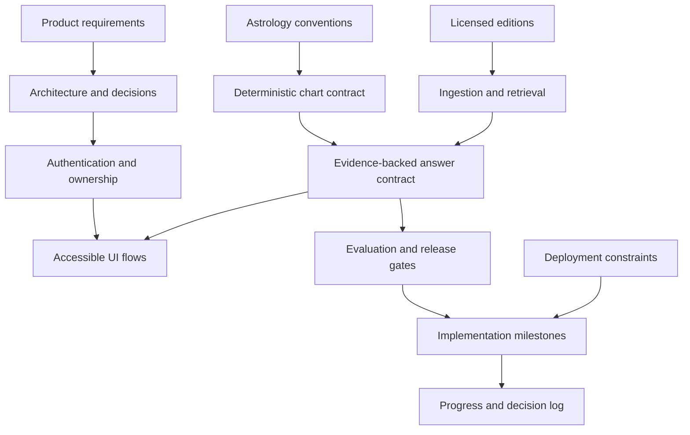

# Context index

Prepared 2026-11-15 and updated during implementation. This is the design and research context library; current code and verification status are in [implementation progress](../implementation/PROGRESS.md), and future continuation guidance is in the [GPT-6.1 Sol handoff](../implementation/GPT-6.1-SOL-IMPLEMENTATION-ARTICLE.md). Proposed research targets are not test results.

For a quick audit of which requirements have code, tests, or open release gates, use the [44-document context-to-code review](../implementation/CONTEXT-CODE-REVIEW.md).

## Recommended reading order

1. [Product and scope](01-product-and-scope.md)
2. [Market research](02-market-research.md)
3. [Architecture](03-architecture.md) and [decision record](04-decisions.md)
4. [Astrology domain](05-astrology-domain.md), [corpus](06-corpus-and-sources.md), [retrieval](07-ingestion-and-retrieval.md)
5. [Authentication and security](08-authentication-and-security.md), [UI and flows](09-ui-and-user-flows.md)
6. [Deployment and costs](10-deployment-and-costs.md), [provider and gateway](11-provider-and-gateway.md)
7. [Data and API contracts](12-data-and-api-contracts.md), [AI context and rules](13-ai-context-and-rules.md)
8. [Code standards and testing](14-code-standards-and-testing.md), [implementation plan](15-implementation-plan.md)
9. [Progress and open decisions](16-progress-and-open-decisions.md), [research register](17-research-register.md)

## How the pieces connect

## Interpretation of status words

- **User requirement:** explicitly requested in the conversation.
- **Proposed default:** an engineering decision made for this plan; user can change it before implementation.
- **Verified source:** readable primary material actually inspected; this does not verify a deployed implementation.
- **Verification target:** a source or behavior still requiring checking.
- **Acceptance target:** a threshold to test later, never a claimed result.
- **Blocked for launch:** must be resolved before external users depend on that capability.

The bibliography is a research and acquisition queue, not a claim that books have been downloaded, read, licensed, or indexed. Product comparison describes public-facing claims, not private implementation details.

## Detailed research dossiers

The expanded research program and its twenty focused assignments are indexed in [42 Expanded research program](42-expanded-research-program.md). Documents 18–41 expand the core specifications with research evidence and implementation details. Read the dossier relevant to your task after the corresponding core document. Unintegrated recommendations in a dossier do not silently override the core architecture or API contracts.

## Configuration reference

[43 Configuration reference](43-configuration-reference.md) consolidates the proposed environment settings, defaults, quota limits and security validation rules. It contains no credentials and is not an executable environment file.

## Rules, rights and trust research

[38 Rule registry](38-rule-registry-and-knowledge-model.md) defines a strict, reviewed condition model with three-valued logic and provenance. [39 Rights audit](39-content-rights-and-license-audit.md) makes each edition/action/provider transmission a separate legal gate and adds SBOM obligations. [40 Trust and validity](40-trust-calibration-and-validity.md) will separate user trust calibration from any empirical validity study. These are release constraints, not completed approvals.

## Publishing and development workflow

Read [the short readiness report](../REPORT.md) and [small commits / continuous verification](44-small-commits-and-continuous-verification.md). The static reading guide lives in docs; it is separate from the future astrology application.
